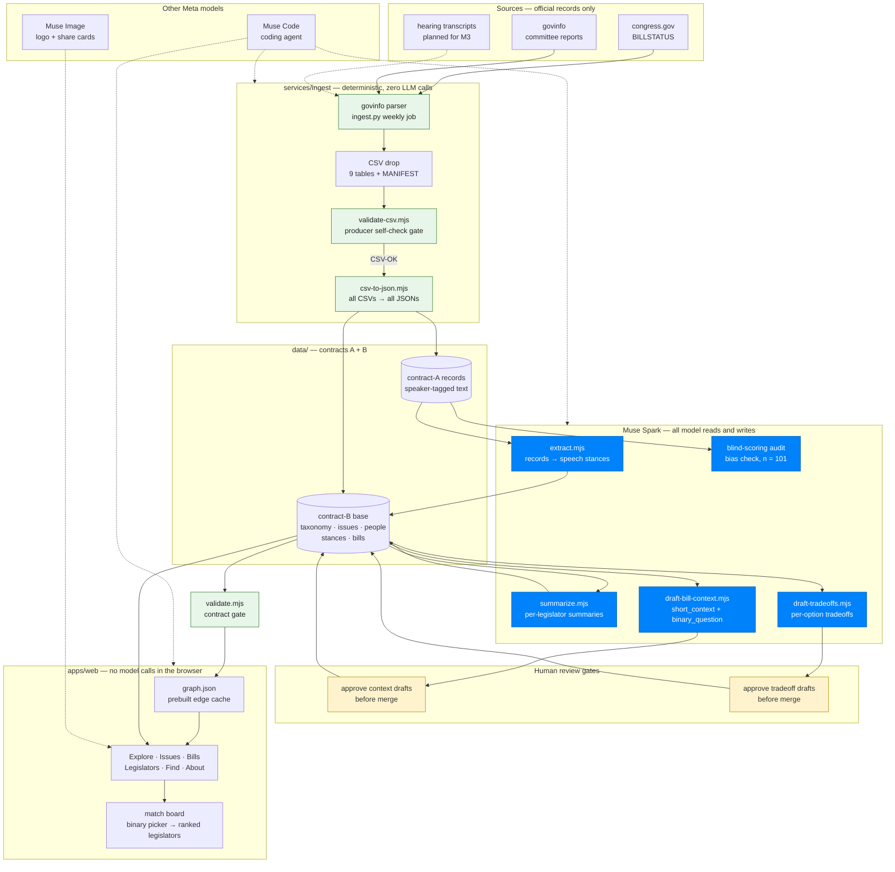

# 🦉 OWL — Open Watch on Legislators

**Live:** https://az30667176-sudo.github.io/owl/

An evidence-anchored knowledge graph of where every U.S. House member stands on every issue.
Built for the **Meta Global AI Developer Hackathon** (Oct 26 – Nov 4, 2026, Indie track, *Build for Your World*).

Pick an issue → see every representative's position on a −1…+1 spectrum, each one backed by the
verbatim quote and the official source that justify it. Pick a representative → see their stances
across every committee, how decisive they are, where they diverge from their party, and when they
flipped. Nothing is asserted without a quote you can click through to.

Stances are extracted and scored by **Muse Spark** (Meta Model API). Every statement carries
`quote`, `source`, `linkage` and `llm_confidence`, so a human can check the model's reading in
one click. Per-legislator summaries are written by Muse Spark too, with every sentence citing the
statements it rests on.

Coverage note: only 130 of 451 members (29%) have speech rows so far — most profiles are
still built from sponsorship and vote records until more hearings are processed.

Inside Explore, every sub-issue carries the real bills under it as one-line yes/no questions.
Answer a few and the **match drawer** under the ring ranks every legislator by how many of your
answered bills their recorded position matches — with party, state and minimum-overlap filters,
and a per-member breakdown of which bills they agree, disagree or have no position on.

## Architecture

Four boxes, three contracts (mirrors the team board):

```
 data producer ──A──► Data pre-processing ──B──► Data process ──C──► Data vis
 congress.gov,          speaker-tagged              Muse Spark:           browser derives
 hearing / floor        records {id, content,       one row per           scores, flips,
 transcripts            source, hints}              statement             heat, graph

 services/ingest        services/ingest             services/process      apps/web
```

| Contract | Boundary | Defined in |
|---|---|---|
| **A** | pre-processing → process: one `record` of speaker-tagged text | `packages/contract/record.schema.json` |
| **B** | process → frontend: `taxonomy`, `issues`, `people`, `stances`, `summaries` `.json` | `packages/contract/*.schema.json` |
| **C** | inside the browser: aggregation, flip detection, heat, filters | `packages/contract/derived.md` |

[`packages/contract/README.md`](packages/contract/README.md) is the single source of truth.
`node packages/contract/validate.mjs <data dir>` checks types, enums, id references, score/direction
consistency, verbatim quotes and summary citations. The Pages workflow runs it before every deploy.

### End-to-end pipeline

Blue = Muse Spark · green = deterministic, zero model calls · yellow = human review gates.
The browser itself never calls a model — every LLM read or write happens in `services/process`,
and every generated field merges only after human approval.



## Repo layout

```
apps/web/                      Data vis
  index.html                     the whole app (HTML + vanilla JS + D3, no build step)
  assets/logo/                   Muse Image logo
data/                          Contract-B data store (process writes, web reads; mock today)
  taxonomy.json · issues.json · people.json · stances.json · summaries.json · bills.json
  records/                       contract-A records (mock sample; real ones optional, used to re-check quotes)
  extracted/                     per-record extraction logs (accepted / rejected / new issues)
packages/contract/             Contracts A / B / C
  README.md                      field-by-field spec, ownership, change process
  *.schema.json                  JSON Schema per file
  derived.md                     what the browser computes (contract C)
  validate.mjs                   zero-dependency checker, used by CI
services/ingest/               Data producer + pre-processing (contract A out)
services/process/              Data process (contract A in, contract B out)
  extract.mjs                    record → statement rows via Muse Spark, with quote/direction/id checks
  summarize.mjs                  statements → per-legislator summary with validated citations
  scoring.mjs                    verbal intensity + position → continuous stance score
  draft-bill-context.mjs         bills → short_context + binary_question drafts (human-reviewed merge)
tools/                         gen-image.mjs (Muse Image) · claude-muse.ps1 (run Claude Code on the Meta Model API)
docs/                          ARCHITECTURE.md (board + ERD) · WORKFLOW.md (issues, labels, gh)
.github/                       Pages deploy (validate data → assemble app + data → publish), issue + PR templates
```

## Workflow (async, issue-driven)

1. Finish a round of work → **open an issue** stating what you need from the other side, in contract terms.
2. Label it `need backend review` / `need frontend review` (+ `contract` if a schema changes).
3. The owning area reviews, resolves or counter-proposes in the thread.
4. PRs reference the issue (`Closes #N`); schema and code change in the same PR.

Labels: `area:ingest` `area:process` `area:web` `contract` `blocked` `P0` `P1`.
Milestones: M1 contract frozen (10/28) · M2 end-to-end on real data (10/31) · M3 submission (11/4).
Cheatsheet: [docs/WORKFLOW.md](docs/WORKFLOW.md).

**Spec-driven changes (OpenSpec).** `openspec/specs/` holds the live specs (data-contract, web-app, process-pipeline). Anything beyond a one-line fix starts as a change: in Claude Code run `/opsx:propose "<what you want>"` (writes proposal, spec delta, design, tasks under `openspec/changes/<name>/`), review it, `/opsx:apply` to implement, `/opsx:archive` to fold the delta into the live specs. CLI: `openspec list`, `openspec validate --all`, `openspec view`.

## Match: questions on bills, answers in Explore

Every bill in `data/bills.json` carries a ≤30-word plain-language `short_context` plus a
`binary_question` with support/oppose options; bills too complex to simplify are tagged
`complex_bill` (longer context, no question, prompt to read the full bill). The questions are
written by Muse Spark from the bill text and reviewed by a human before they ship.

In the app the questions live where the bills do: open a committee on the Explore ring, click a
sub-issue, and its bills appear in the side pane as Yes / No rows (the label shows how many,
e.g. "Small Business Programs · 40?"). Bill pages show the same question under "What this bill
does". Answers are stored in the browser only. After three answers the drawer under the ring
ranks every legislator: match = bills answered the same way as you, out of all bills you
answered (no recorded position counts as no match); click a member to see the bills grouped
into same / opposite / no position. Filters: state, party, minimum overlap. The summary strip
is template text built from your answers and bill fields — the browser never calls a model.

Match attributes are drafted by Muse Spark and merged only after human review:

```bash
node services/process/draft-bill-context.mjs data --top 782 --csv <csv-drop> --out data/bill_context.full.json
# review drafts, set approved:true, then:
node services/process/draft-bill-context.mjs data --merge --out data/bill_context.full.json
node packages/contract/validate.mjs data --records data/records
```

## Quick start

```bash
cp .env.example .env                                  # MODEL_API_KEY (Meta Model API), CONGRESS_API_KEY
python -m http.server 8090                            # from the repo root; open http://localhost:8090/apps/web/
node packages/contract/validate.mjs data --records data/records
node services/process/extract.mjs data/records/record-hearing-mock.json   # one record → statements
node services/process/summarize.mjs                                                    # statements → summaries
```

## Meta models used

Everything the model does happens offline and lands in the repo as data a human can check; the
browser only renders it.

- **Muse Spark 1.3** (`services/process`)
  - stance extraction: hearing and floor transcripts → one row per statement with a −1…+1 score,
    direction, verbatim `quote`, `source` and `llm_confidence` (`extract.mjs`, `extract-batch.mjs`)
  - conditions: "I would vote yes if…" statements → the demands registry in `conditions.json`
    (`extract-conditions.mjs`)
  - per-legislator summaries, every sentence citing a statement id (`summarize.mjs`)
  - bill context + yes/no questions for 782 bills, drafted then human-reviewed
    (`draft-bill-context.mjs`)
  - issue-taxonomy review and a blind re-scoring audit without names or parties
    (`review-issues.mjs`, `audit/`)
- **Muse Image 1.0** — the OWL mark and shareable cards (`tools/gen-image.mjs`)
- **Muse Code** — wrote most of `apps/web/index.html` headlessly from OpenSpec change
  documents (commits carry `Co-Authored-By: Muse Code`); `tools/claude-muse.ps1` points Claude
  Code at the Meta Model API for the same purpose

## Team

Owl — Kurt (`az30667176-sudo`, frontend + contracts) and two teammates (ingest, process).
